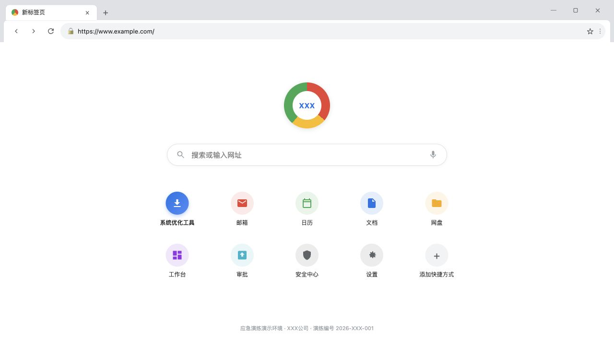
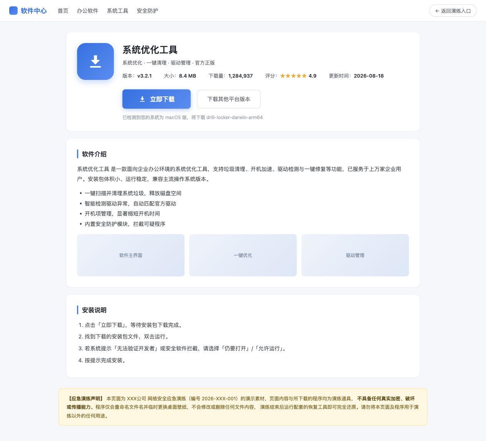

# 勒索病毒应急演练演示套件

一套用于安全意识培训、应急处置演示和演练复盘的 Rust 工具，串起「仿冒下载 / 钓鱼邮件 → 运行演练程序 → 发现异常 → 恢复」的完整流程。

文件“锁定”通过追加 `.drill_locked` 后缀实现，**不对目标文件进行加密或修改其内容**。演练程序还可生成模拟勒索信、显示仿 Wana Decrypt0r 弹窗，并在 macOS / Windows 上更换桌面壁纸；恢复工具依据清单还原文件名，并尝试恢复原壁纸。

> 仅在专用演练目录中使用样本文件。程序会实际重命名文件、写入恢复清单和模拟勒索信；默认运行还会尝试更换壁纸。只展示场景时，打开静态网页即可，无需运行演练程序。

## 界面预览

以下为默认示例配置生成的静态页面实截图，单位名、域名、邮件与软件介绍均为演练素材。截图过程仅浏览页面，未运行演练或恢复程序。

### 演练入口

从同一入口选择下载或邮件场景，底部提供恢复工具下载。


### 文件下载勒索：仿浏览器

下载路径：`index.html → browser.html → search.html → download.html`。先进入仿浏览器，通过搜索框或软件快捷入口打开模拟搜索结果。



### 文件下载勒索：仿搜索结果

搜索框提交后展示本地模拟结果，置顶广告进入仿下载站。下图包含搜索结果、相关搜索及页面底部的演练声明。


### 文件下载勒索：仿软件下载站

下载站展示软件信息、下载入口、功能介绍和安装文案。下图保留从顶部导航到页面底部演练声明的完整内容。



### 邮件勒索：仿邮箱与钓鱼附件

邮件路径：`index.html → mail.html → 模拟附件下载`。默认场景以人事通知和双扩展名附件展示钓鱼手法。下图完整展示邮箱导航、收件箱、发件人、邮件正文，以及底部的 `2026年度工资调整明细表.xlsx.exe` 附件。


**网页下载不会自动运行程序。** 下载后的文件只有在参演者另行运行时，才会触发文件改名、弹窗等演练行为。

## 功能与平台

| 能力 | 说明 |
| --- | --- |
| 场景页面 | 演练入口、仿浏览器、仿搜索结果、仿下载站、仿邮箱 |
| 模拟文件锁定 | 追加可配置后缀，支持递归、按名称排除、文件数量上限 |
| 异常现象 | 模拟勒索信、带倒计时的弹窗、演练壁纸 |
| 恢复工具 | 优先按 `manifest.json` 还原；清单缺失时按配置后缀扫描恢复 |
| 统一定制 | 单位名称、域名、文案、外观和行为集中在 `config/drill.toml` |
| 分发打包 | 生成网页、壁纸、各平台可执行文件及启动 / 恢复脚本 |

| 平台 | 产物后缀 | 文件改名 / 恢复与弹窗 | 自动更换 / 恢复壁纸 |
| --- | --- | --- | --- |
| macOS Apple Silicon | `darwin-arm64` | 已实现 | 已实现，受系统权限影响 |
| Windows x64 / ARM64 | `windows-amd64.exe` / `windows-arm64.exe` | 已实现 | 已实现 |
| Linux x64 / ARM64 | `linux-amd64` / `linux-arm64` | 已实现，弹窗需要图形会话 | 暂不支持 |

表中为代码支持范围，不代表各平台均已完成实机验收。打包会先构建本机，再尝试交叉编译 Windows 和 Linux；交叉编译失败的目标会警告并跳过，**打包成功不代表包含所有平台程序**。

## 快速开始

### 1. 构建分发包

准备 Rust / Cargo 和系统中文字体，在仓库根目录执行：

```bash
cargo run -p xtask -- package
```

结果位于 `dist/`，包含五个 HTML 页面、`wallpaper.png`、成功构建的平台程序、启动 / 恢复脚本和 `演练说明.txt`。再次打包会清空并重建 `dist/`，请勿在其中保留需要长期保存的文件。

### 2. 只预览页面

打开生成的 `dist/index.html`，即可浏览两条演练路径。只做培训展示时，停留在网页即可；下载按钮指向同目录下的演练或恢复工具。

### 3. 在受控目录中试跑

下面以 macOS Apple Silicon 为例，**仅将 `drill-sandbox` 用作可丢弃的样本目录**。其他平台请换成对应可执行文件名。

```bash
# 创建专用目录与一份文本样本
mkdir -p drill-sandbox
printf '仅用于应急演练的样本\n' > drill-sandbox/sample.txt

# 预览范围；禁用壁纸访问
./dist/drill-locker-darwin-arm64 --root ./drill-sandbox --dry-run --no-wallpaper

# 执行文件改名与模拟勒索信写入，不更换壁纸、不弹窗
./dist/drill-locker-darwin-arm64 --root ./drill-sandbox --no-wallpaper --no-gui

# 先预览恢复，再执行
./dist/drill-restorer-darwin-arm64 --root ./drill-sandbox --dry-run
./dist/drill-restorer-darwin-arm64 --root ./drill-sandbox --yes
```

试跑后，`sample.txt` 会先变成 `sample.txt.drill_locked`，恢复时去掉后缀，内容保持不变。`manifest.json` 会保留在演练目录中，便于核对记录。

需要展示弹窗时，去掉 `--no-gui`；需要展示壁纸变化时，请在专用演练机器或虚拟机内去掉 `--no-wallpaper`。**`--root` 仅约束文件操作范围，不能隔离桌面壁纸等系统效果。**

### 4. 分发与现场操作

将整个 `dist/` 拷贝至演练机器的专用目录，再放入样本文件。脚本按机器架构选择同目录程序：

| 系统 | 启动演练 | 执行恢复 |
| --- | --- | --- |
| macOS | `start-drill.command` | `restore.command` |
| Windows | `start-drill.bat` | `restore.bat` |
| Linux | `./start-drill.sh` | `./restore.sh` |

**未传 `--root` 时，演练和恢复工具均以可执行文件所在目录为根，而非终端当前目录。** 启动脚本会触发默认演练效果；需要指定范围或禁用壁纸 / 弹窗时，使用上面的命令行方式。

## 命令行选项

| 选项 | 演练工具 `drill-locker` | 恢复工具 `drill-restorer` |
| --- | --- | --- |
| `-r, --root <目录>` | 指定演练目录 | 指定恢复目录 |
| `-n, --dry-run` | 预览改名，不改文件、不换壁纸、不弹窗 | 预览恢复，不执行修改 |
| `--no-wallpaper` | 不读取或更换桌面壁纸 | — |
| `--no-gui` | 不显示弹窗 | — |
| `-y, --yes` | — | 跳过交互确认 |
| `-h, --help` | 显示帮助 | 显示帮助 |
| `-V, --version` | 显示版本 | 显示版本 |

`--dry-run` 若不配合 `--no-wallpaper`，演练工具仍会尝试读取当前壁纸信息。恢复工具在非交互环境中执行文件恢复时需使用 `--yes`。

## 按单位与场景定制

修改 [config/drill.toml](config/drill.toml) 后重新执行 `cargo run -p xtask -- package`。配置在编译期嵌入程序，修改分发目录旁的配置文件不会改变现有二进制。

| 配置段 | 可调整内容 |
| --- | --- |
| `[organization]` | 单位全称、简称、演练编号 |
| `[identity]` | 内部域名、外部示例域名 |
| `[lock]` | 改名后缀、递归开关、文件数量上限、排除名称 |
| `[wallpaper]` | 分辨率、标题、配色、字体路径、演练水印 |
| `[popup]` | 窗口标题、正文、模拟联系方式、金额、倒计时、演练声明 |
| `[ransom_note]` | 是否生成模拟勒索信、文件名、识别码前缀、正文 |
| `[portal]` | 入口标题、场景卡片、恢复区文案 |
| `[browser]` / `[search]` | 仿浏览器、快捷方式、搜索品牌、结果与相关搜索 |
| `[web]` | 仿下载站品牌、软件信息、介绍、安装文案 |
| `[mail]` | 仿邮箱、发件人、正文、附件名、其他邮件 |

文案支持 `{org}`、`{short_name}`、`{drill_code}`、`{domain}`、`{external_domain}`、`{download_name}` 等占位符，完整说明见配置文件开头。默认递归处理，文件数量上限为 `50000`；排除项按文件名或目录名精确匹配。

## 操作范围与恢复边界

- 文件锁定使用重命名，不加密目标文件内容；同时会写入 `manifest.json`，并按配置生成模拟勒索信。演练 / 恢复程序不主动联网。
- 系统目录及其子目录禁止作为演练根目录；家目录、桌面、文档等关键目录本身也会被拒绝，其下的专用子目录可用于演练。遍历跳过符号链接。
- 文件数量超限时中止；先写恢复清单再改名，已有清单的记录会增量合并。请保留清单并在原位置恢复，其中记录了文件路径。
- 恢复遇到同名目标文件会跳过，不覆盖；找不到的文件或操作失败会在输出中报告。关闭弹窗并不会自动恢复文件。
- 原壁纸路径需成功记录且仍可用，系统也需允许设置壁纸，才能自动还原。Linux 需手动设置壁纸。
- 清单缺失时，仅能按当前配置后缀恢复文件名，无法自动恢复原壁纸，也无法根据清单清理模拟勒索信。清单损坏时会报错，不会自动退回后缀扫描。
- 恢复会删除清单登记且名称与当前配置匹配的模拟勒索信。演练前应确保样本目录没有与配置中勒索信文件名相同的重要文件。

## 开发与构建

```text
config/drill.toml       单位、场景与行为配置
web/                   五个页面的 HTML 模板
crates/drill-core/     配置、遍历、护栏、改名、清单、恢复与壁纸
crates/drill-locker/   演练命令行与 egui 弹窗
crates/drill-restorer/ 恢复命令行
crates/drill-webgen/   网页生成工具
crates/xtask/          构建、打包、样本与壁纸生成
docs/screenshots/      README 静态页面截图
dist/                  生成的分发包（不入库）
```

常用命令：

```bash
cargo test
cargo run -p xtask -- help
cargo run -p xtask -- build
cargo run -p xtask -- sandbox
cargo run -p xtask -- wallpaper
```

`sandbox` 默认清空并重建 `target/drill-sandbox`，仅用于生成可丢弃样本；`wallpaper` 只生成 `dist/wallpaper.png`，不设置桌面壁纸。修改 `web/*.html` 后需要重新打包以更新分发页面。

### 从 macOS 交叉编译

以下为打包工具使用的目标与链接器配置；工具链准备好后重新运行 `package`。

```bash
# Windows x64
brew install mingw-w64
rustup target add x86_64-pc-windows-gnu

# Linux x64 / ARM64
brew tap messense/macos-cross-toolchains
brew install x86_64-unknown-linux-gnu aarch64-unknown-linux-gnu
rustup target add x86_64-unknown-linux-gnu aarch64-unknown-linux-gnu

# Windows ARM64：先自行准备 llvm-mingw
# LLVM_MINGW_BIN 可指向其根目录或 bin 目录
export LLVM_MINGW_BIN=/path/to/llvm-mingw
rustup target add aarch64-pc-windows-gnullvm
```

Linux 弹窗需要 X11 / Wayland 图形环境。中文字体可由系统自动探测，或通过 `[wallpaper].font_path` 指定。分发前请在对应演练环境验证预览、改名与恢复流程。
